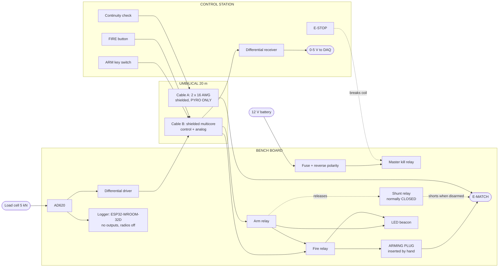

# TALAVERA v1 — Static Test Bench Electronics

**Ignitia Rocket Lab** — Student rocketry team, Tecnológico de Monterrey, Campus Guadalajara

Replacement electronics for the **Wirikuta 1.1** solid-motor static test bench. TALAVERA removes the
microcontroller from every function the test's safety depends on. Arming, firing and emergency stop are
switches, relay contacts and resistors — no firmware anywhere in the chain. A logger rides along to
record thrust, with no authority over anything.

> ### ⚠️ Status: PRELIMINARY — NOT APPROVED, NOT BUILT
>
> No circuit in this repository is approved. No board has been fabricated. Nothing has been energized.
> The schematics are **empty skeletons** — Gate 2 has not started.
>
> Pyrotechnic, actuator, battery, motor and high-current circuits require written sign-off from the
> named review owner before any bring-up. See **[docs/SAFETY.md](docs/SAFETY.md)**.

---

## Why replace Wirikuta's electronics

Wirikuta 1.1 works, but its reliability rests on an Arduino running a nine-state machine that must
execute correctly for the bench to be safe. Two defects found in the shipped firmware show the problem
with that arrangement:

| Defect | Consequence |
|---|---|
| `SERVO_PIN 5` and `BUTTON_PIN 5` are both defined and both passed to `pinMode` | The servo gating the igniter line shares a pin with an unrelated input |
| `igniteMotor()` contains `currentIgniterState == true;` — a comparison, not an assignment | `getMosfetState()` reports *not firing* while the igniter is energized |

Neither is a deep bug. Both are the kind firmware keeps producing. Both disappear when the arm and fire
path is wire and discretes.

---

## Design targets

| Target | Value | Basis |
|---|---|---|
| Safe state without firmware | Every output, named and de-energized | Requirement |
| MCU on safety path | **None** | Requirement |
| Umbilical length | **20 m**, extensible to 40 m+ | Decision D-011 |
| Igniter channels | 1 | Decision D-015 |
| Thrust measurement | Improve on current noise floor (1-grain motors unresolvable today) | Manual p. 28 |
| Max motor class | **TBD** — total impulse, not peak thrust | Open item |
| Operating temperature | 0 to +55 °C ambient *(assumed)* | Open item |
| Fabrication | **Bare PCB, 2-layer, hand-assembled** for rev A. Parts must be cheap, reliably sourced from LCSC or UNIT, and hand-solderable. | D-051, D-052 |
| Safety relays | **One part ×4:** `SRD-12VDC-SL-C` SPDT, 12 V coil. K3 wired NC for the shunt, the rest NO. ~$0.23, ~131,800 in LCSC stock. | D-055 |

> **Standoff deviation, logged:** a 20 m umbilical yields roughly 15–17 m of real standoff after cable
> routing. NAR/TRA minimum personnel distance for even an H-class motor is 30 m, or 22.5 m with the
> 25 % static-test reduction the manual permits (pp. 7–8). Operating at 20 m is an accepted deviation
> recorded as **D-007**, not a design constraint. Extending the umbilical is a cable purchase — the
> boards do not change.

---

## What changed from Wirikuta 1.1

| Area | Wirikuta 1.1 | TALAVERA v1 | Why |
|---|---|---|---|
| Command link | NRF24L01 radio | **Wired umbilical** | RF cannot carry a hardware-only arm/fire path |
| Control logic | Arduino, 9-state machine | **None on safety path** | Removes an entire class of defect |
| Arming | MG995 servo moves a toggle | **Bench arming plug + station key switch** | Three series elements, no actuator |
| Igniter safe state | Open (MOSFET off) | **Shorted**, normally-closed contact | 20 m of wire is a pickup loop |
| Thrust signal | Single-ended on board | **Differential**, driven off board | Directly addresses the p. 28 noise floor |
| Pyro / analog cabling | Shared harness | **Two separate shielded cables** | 5 A at *t=0* beside a strain gauge corrupts data |
| LED beacon | Driven from a software variable | **Driven from the real ARM/FIRE signals** | The beacon must not be able to lie |
| Data logging | On-bench, inside the state machine | **On-bench, but a passenger with no outputs** | Keeps local logging, removes its authority |
| Logger processor | Arduino UNO, 5 V | **ESP32-WROOM-32D**, 3.3 V | More capable; 3.3 V is native for SD and I²C, so level shifting disappears |
| Logger software | 9 states, commands, RF, diagnostics | **Records while RECORD is closed. No states.** | Also yields a clean CSV with nothing to hand-strip |
| Logger radio | NRF24L01 active, in the safety path | **Wi-Fi/BT present but stopped at boot** | EMI next to the strain front end and the pyro cable, not a command risk |
| Boards | 2 bench + 1 station, JST-XH between | **1 bench + 1 station** | Drops an interconnect |

---

## Hardware specifications

Every row is labelled **V** (verified from a datasheet or the Wirikuta manual, with page),
**A** (assumed, needs confirmation) or **TBD**.

| Item | Specification | Evidence |
|---|---|---|
| Supply | 12 V nominal, 2.6 Ah SLA | **V** — manual p. 5 |
| Load cell | 5,000 N full scale | **V** — manual p. 4 |
| Load cell model / mV/V / bridge R | — | **TBD** — blocks analog chain design |
| Instrumentation amp | AD620 (carried over) | **V** — manual p. 19 |
| Regulation | Linear, LM78xx family | **A** — kept deliberately; a switcher injects noise into the strain front end |
| Logger processor | **ESP32-DevKitC V4 (ESP32-WROOM-32D)**, 3.3 V | Decision D-028 |
| Logger ADC | **ADS1220IPWR** — 24-bit, **SPI**, 2 kSPS, integrated PGA ×1–128. Stocked at **both** UNIT and LCSC (C48263). Replaces the ADS1115 and its I²C bus. | D-046 |
| Analog front end | ADS1220 internal PGA is primary. **AD620 footprint laid out with 0 Ω bypass links**, hand-populated, so both chains can be A/B tested. | D-046 |
| Logger power | **Upstream of the master kill relay**, own fuse and switch, so an E-STOP cannot corrupt the data file | D-047 |
| | *ESP32 internal SAR ADC remains excluded* — too nonlinear for a noise-limited strain measurement | D-030 |
| Logger radios | **Wi-Fi and Bluetooth stopped at boot, never enabled** | D-029 |
| Logger mounting | Socketed DevKitC vs. soldered WROOM-32D | **TBD** — vibration decision, open item |
| Storage | **Embedded microSD socket on-board**, porting the IGNIS-v5 `Storage.SchDoc` topology with an `SD_DETECT` line | D-037 |
| Secondary telemetry | **RS-485** (`SP3485EN`, ~$0.20) over the umbilical, **USB-C on the station board**, built in rev A. Isolation sits at the station and is powered by the laptop's USB, so no isolated DC-DC is needed. Direct USB rejected — 5 m spec vs. 20 m run. | D-038, D-048, D-056 |
| Igniter drive | 1 channel, low-side, with NC shunt | **A** — pending e-match spec |
| E-match no-fire / all-fire current | — | **TBD** — blocks every margin claim |
| Firing pair | 2 × 16 AWG shielded, own cable | **V** — computed, see below |
| Control / analog cable | 8–10 conductor shielded, one twisted pair | **A** |
| Board size | 100 × 80 mm bench, 80 × 60 mm station | **A** — placeholder in the KiCad files |
| Layers | 2 | **A** — pending fab choice |

**Firing loop resistance** — standard AWG table, copper at 20 °C; add roughly 14 % at +55 °C:

| Wire | 20 m cable (40 m loop) | 40 m cable (80 m loop) |
|---|---|---|
| 18 AWG | 0.84 Ω | 1.67 Ω |
| **16 AWG** | **0.53 Ω** | **1.06 Ω** |
| 14 AWG | 0.33 Ω | 0.66 Ω |

With 16 AWG, a 1.5 Ω e-match and 12 V: **5.8 A at 20 m, 4.6 A at 40 m** — far above a typical 1 A
all-fire. Cable resistance is not the binding constraint at either length.

**Stray cable capacitance cannot fire a match.** At 50–100 pF/m, 40 m of pair holds 2–4 nF. At 12 V
that stores ½CV² of roughly **290 nJ**, four to five orders of magnitude below a millijoule-class
no-fire energy.

---

## System architecture



### The firing chain is three things in series

```
STATION (20 m away)                    BENCH

[ARM key] ──── arm line ─────────►  [arm relay]
                                          │
[FIRE button] ── fire line ───────►  [fire relay]
                                          │
                                   [ARMING PLUG]  ◄── inserted by hand, last
                                          │
                                     ╔════╧════╗
                                     ║ E-MATCH ║
                                     ╚════╤════╝
                                          │
                              [shunt relay, normally CLOSED]
                                    shorts the match
                                    until ARM is turned
```

Three independent things must all be true to pass current: the key is turned, the button is held, and a
human walked to the bench and inserted the plug. With any one absent the match is not merely open — it
is **shorted to itself** by the normally-closed shunt.

---

## Safe states

Every output's safe state is its **de-energized** state. Battery death, a cut cable, a dropped relay
coil and an e-stop press all land in the same place, with no firmware involved.

| Output | Safe state | Achieved by |
|---|---|---|
| Igniter | `PYRO_SHUNTED` | NC relay contact shorts the match pair; de-energized = shorted |
| Arm path | `DISARMED` | NO relay open, key removed, plug withdrawn |
| Fire path | `FIRE_OPEN` | Momentary NO button, never latching |
| Bench power | `BENCH_UNPOWERED` | Master relay is NO; e-stop breaks its coil so it drops out |
| Load cell excitation | `EXCITATION_OFF` | On the master rail |
| LED beacon | `BEACON_DARK` | On the master rail — darkness means de-energized |
| Logger | `LOGGER_IDLE` | No outputs by construction; cannot affect any of the above. Radios stopped at boot. |

Full hazard analysis and the rationale for each state: **[docs/SAFETY.md](docs/SAFETY.md)**

---

## Repository structure

```
TALAVERA-v1-TestBench/
├── docs/
│   ├── OPERATIONS-MANUAL.md      Preliminary field manual
│   ├── SAFETY.md                 Safe states, hazard table, prohibited actions
│   ├── REQUIREMENTS.md           Gate 0 output: functions, scope, open items
│   ├── SCHEMATIC-PLAN.md         Gate 2 readiness: sheets, symbols, footprints
│   ├── AUDIT-2026-11-06.md       Pre-fabrication audit: 5 critical, 3 high, 4 medium
│   ├── ADC-TRADE-STUDY.md        Replacing the ADS1115: options and recommendation
│   ├── UMBILICAL-AND-TELEMETRY.md  Three data paths; why direct USB fails at 20 m
│   └── DECISION-LOG.md           Every decision, reason, date, approver
├── hardware/
│   ├── talavera-bench/           KiCad 10 project — bench board
│   ├── tools/                    Schematic generators (ksch.py + per-board scripts)
│   ├── talavera-station/         KiCad 10 project — control station board
│   └── libraries/                Project symbols, footprints, 3D models
├── firmware/
│   └── logger/                   Thrust logger. NO safety authority.
├── fabrication/
│   ├── PARTS-LIST.md             Preliminary parts list, IGNIS/MAGNIS format
│   ├── TALAVERA_v1_Parts_List_bench.csv     Spreadsheet version
│   ├── TALAVERA_v1_Parts_List_station.csv
│   ├── bench/                    Gerbers, drill, BOM, centroid (Gate 6 only)
│   └── station/
├── analysis/
│   └── kalman/                   Post-test thrust processing
└── test/
    ├── BRINGUP-PLAN.md           Staged power-up procedure
    └── reports/                  Per-test records
```

---

## Design gate status

Work proceeds one gate at a time. No gate starts before the previous one is approved.

| Gate | Scope | Status |
|---|---|---|
| 0 | Requirements and reference | ✅ Complete |
| 1 | Architecture | ⬜ Awaiting approval |
| 2 | Schematic | 🔴 **Drawn, then failed audit** — see [docs/AUDIT-2026-11-06.md](docs/AUDIT-2026-11-06.md). 5 critical findings. **Not fit to build.** Originally — both boards, 96 components. Values on the pyro and analog blocks await O-1/O-2. |
| 3 | Components, sourcing, second sources | ⬜ Not started |
| 4 | Layout | ⬜ Not started |
| 5 | ERC / DRC clean | ⬜ Not started |
| 6 | Fabrication package | ⬜ Not started |
| 7 | Bring-up plan | ⬜ Not started |

---

## Design & Development

**Author & Lead Designer:** Sofia Pacheco Leon  
Ignitia Rocket Lab · Avionics & Electronics

**Co-Author:** Claude (Anthropic) — architecture review, documentation, KiCad project scaffolding

**Team Leader:** Maximiliano Funoy  
**Division Leader & Vice President:** [Emilio Guadarrama](https://github.com/Emilio-Guadarrama)  
**Faculty Advisor:** Dr. José Luis Henríquez Mercado

**Design Review Owner:** [Emilio Guadarrama](https://github.com/Emilio-Guadarrama)  
Signs off pyrotechnic, actuator, battery and high-current circuits.

Reference design for the storage and USB subsystems:
[IGNIS-v5 Flight Computer](https://github.com/Emilio-Guadarrama/IGNIS-v5-FlightComputer).

## Team

**Ignitia Rocket Lab**  
Tecnológico de Monterrey, Campus Guadalajara

Predecessor Wirikuta 1.1 is documented in *Manual de operaciones: WIRIKUTA 1.1 Banco de Pruebas*,
August 2025.

---

## License

This project is open source under the [MIT License](LICENSE). You are free to use, modify and share the
design, as long as the original copyright notice is kept.

The licence carries an **additional safety notice**: it grants permission to use these files, not any
assurance that the design is safe, complete or correct. Anyone building or operating this hardware is
responsible for their own safety review and for compliance with their national rocketry association's
safety code.

---

**Contact the author:** Sofia Pacheco Leon · [sofi.pacheco.leon@gmail.com](mailto:sofi.pacheco.leon@gmail.com)
